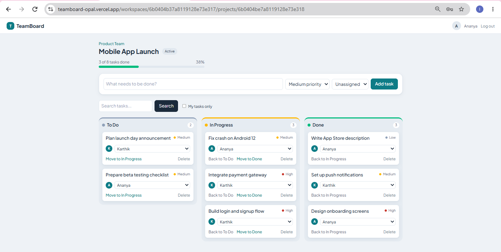
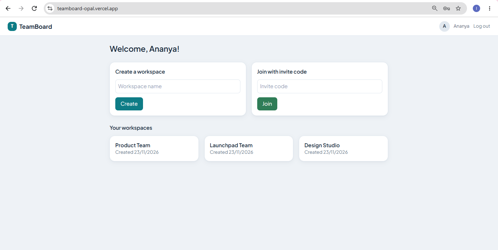
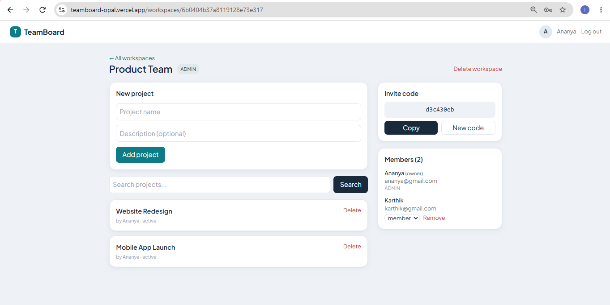
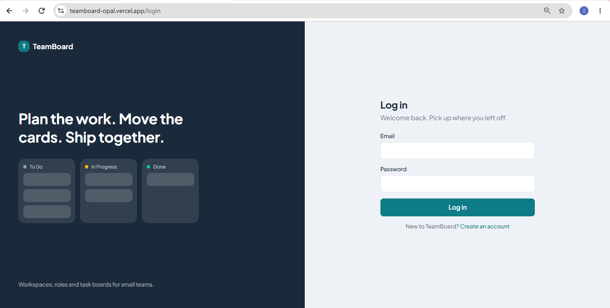
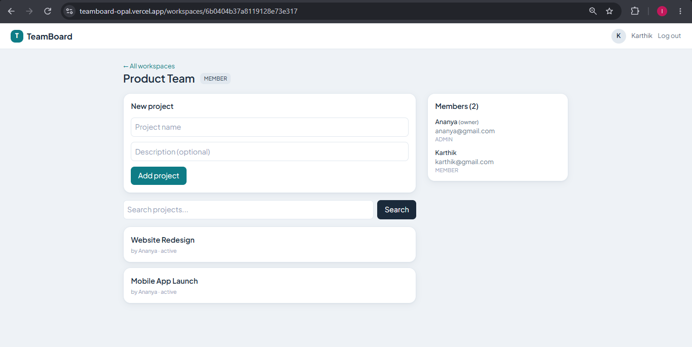
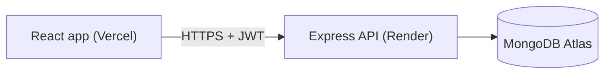
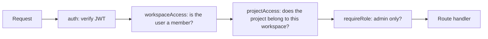
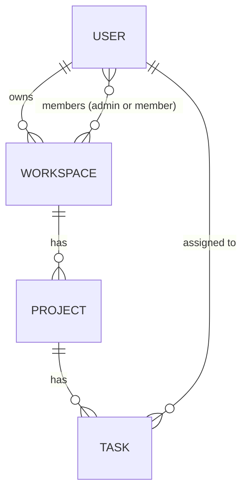

# TeamBoard

A multi-tenant task management app (think a small Trello/Jira). Teams get their own workspace, invite members with a code, manage projects, and move tasks across a To Do / In Progress / Done board. Access is controlled by roles, and every workspace's data is isolated from every other workspace.

**Live demo:** https://teamboard-opal.vercel.app
**API:** https://teamboard-api-ocdm.onrender.com/api/health

> The API runs on a free hosting plan that sleeps after 15 minutes of inactivity. The first request after a quiet period can take about a minute while the server wakes up. No email verification: register with any email to try it.



## Features

- **Authentication:** register and login with JWT, passwords hashed with bcrypt, protected routes on the frontend and API
- **Multi-tenant workspaces:** each workspace is a separate tenant; a user can belong to many
- **Invite codes:** members join with a code; admins can regenerate it
- **Role-based access control:** `admin` and `member` roles enforced in API middleware (not just hidden in the UI); the workspace owner can't be demoted or removed
- **Projects:** create, edit, archive and delete (admin only), with search and pagination
- **Tasks:** status workflow (To Do, In Progress, Done), priority, assignment to workspace members, search and "my tasks" filter
- **Permission-aware actions:** a task can be deleted by an admin or by whoever created it
- **Cascade deletes:** deleting a project removes its tasks; deleting a workspace removes its projects and tasks
- **Progress view:** per-project progress bar based on completed tasks

## Screenshots

| Workspaces                                    | Workspace and members                        |
| --------------------------------------------- | -------------------------------------------- |
|  |  |

| Login                                | Member view (no admin controls)                  |
| ------------------------------------ | ------------------------------------------------ |
|  |  |

## Tech stack

| Layer    | Technology                                                            |
| -------- | --------------------------------------------------------------------- |
| Frontend | React (Vite), React Router, Axios, Context API, Tailwind CSS v4       |
| Backend  | Node.js, Express 5, Mongoose                                          |
| Database | MongoDB Atlas                                                         |
| Auth     | JWT, bcryptjs                                                         |
| Hosting  | Vercel (frontend), Render (API), MongoDB Atlas (database)             |
| Deploys  | Automatic on every push to `main` (Vercel and Render Git integration) |

## Architecture



Every workspace-scoped request passes through a chain of middleware, so a handler only runs once the caller is authenticated, is a member of the workspace, and has the right role.



### Data model



### How tenant isolation works

- Projects and tasks store the `workspace` they belong to.
- Every query filters by both the resource id and the workspace from the URL, so a valid project id from another workspace returns `404`.
- Assignees are validated against the workspace's member list before a task is saved.

## API reference

All routes except register and login need `Authorization: Bearer <token>`.

**Auth**

| Method | Route                | Notes                  |
| ------ | -------------------- | ---------------------- |
| POST   | `/api/auth/register` | name, email, password  |
| POST   | `/api/auth/login`    | returns token and user |
| GET    | `/api/auth/me`       | current user           |

**Workspaces** (`/api/workspaces`)

| Method | Route                       | Who                                          |
| ------ | --------------------------- | -------------------------------------------- |
| POST   | `/`                         | any user (creator becomes admin and owner)   |
| GET    | `/`                         | workspaces the user belongs to               |
| POST   | `/join`                     | join with `inviteCode`                       |
| GET    | `/:id`                      | members (invite code only visible to admins) |
| PATCH  | `/:id`                      | admin: rename                                |
| DELETE | `/:id`                      | owner only                                   |
| POST   | `/:id/invite-code`          | admin: new invite code                       |
| PATCH  | `/:id/members/:userId/role` | admin: change role                           |
| DELETE | `/:id/members/:userId`      | admin: remove member                         |

**Projects** (`/api/workspaces/:id/projects`)

| Method     | Route                    | Who     |
| ---------- | ------------------------ | ------- |
| POST       | `/`                      | members |
| GET        | `/?search=&page=&limit=` | members |
| GET, PATCH | `/:projectId`            | members |
| DELETE     | `/:projectId`            | admin   |

**Tasks** (`/api/workspaces/:id/projects/:projectId/tasks`)

| Method     | Route                                   | Who                               |
| ---------- | --------------------------------------- | --------------------------------- |
| POST       | `/`                                     | members                           |
| GET        | `/?status=&priority=&assignee=&search=` | members (`assignee=me` supported) |
| GET, PATCH | `/:taskId`                              | members                           |
| DELETE     | `/:taskId`                              | admin or task creator             |

## Run it locally

Requirements: Node.js 20+ and a MongoDB connection string (a free Atlas cluster works).

```bash
git clone https://github.com/<username>/teamboard.git
cd teamboard
```

**Backend**

```bash
cd server
npm install
```

Create `server/.env`:

```
PORT=5000
MONGO_URI=mongodb+srv://<user>:<password>@<cluster>.mongodb.net/teamboard
JWT_SECRET=<a long random string>
```

```bash
npm run dev
```

**Frontend** (in a second terminal)

```bash
cd client
npm install
```

Create `client/.env`:

```
VITE_API_URL=http://localhost:5000/api
```

```bash
npm run dev
```

Open http://localhost:5173.

For production, set `CLIENT_URL` on the API to the deployed frontend origin so CORS allows it.

## Design decisions and trade-offs

- **Invite codes instead of email invites:** simple and works without an email provider. Email invites are a planned improvement.
- **JWT in `localStorage`:** easy to build and fine for a demo, but exposed to XSS. A production version would use httpOnly cookies and short-lived access tokens with refresh tokens.
- **Authorization lives in the API:** the UI hides admin controls for convenience, but the middleware is what actually enforces permissions.
- **Move buttons instead of drag and drop:** fewer moving parts and easy to test; drag and drop is a possible upgrade.
- **Free hosting:** the API sleeps when idle, so the first request can be slow.

## Roadmap

- [ ] Automated tests (API integration tests with Jest and Supertest)
- [ ] Email invites
- [ ] Drag-and-drop board
- [ ] Refresh tokens and httpOnly cookies
- [ ] Task comments and due dates
- [ ] Rate limiting and security headers (`express-rate-limit`, `helmet`)

## Author

Built by Lavanya as a full-stack portfolio project.
